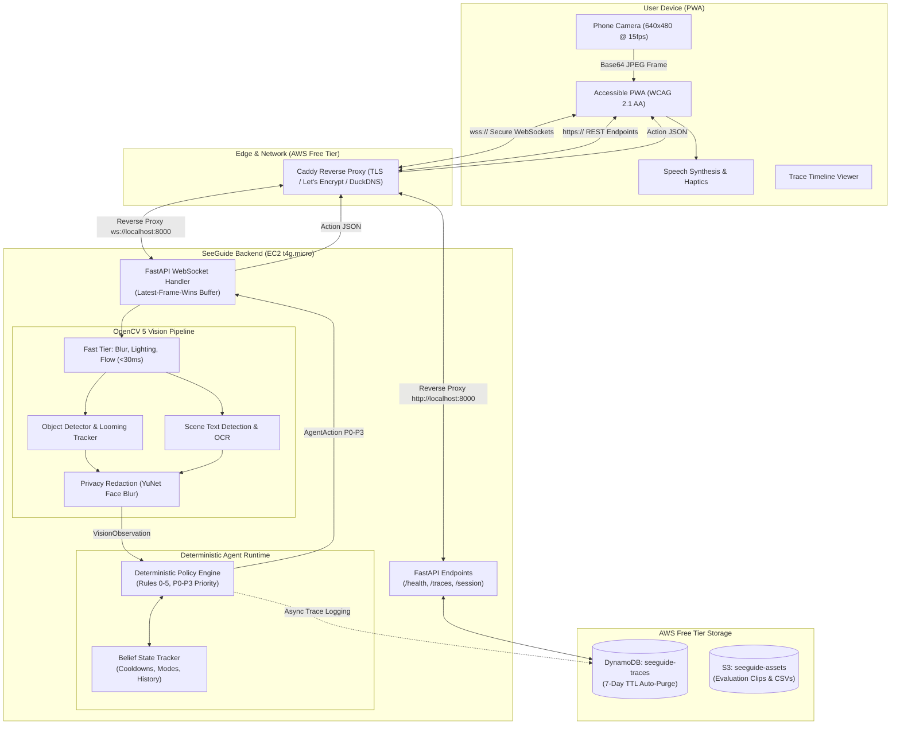

# SeeGuide

> **CRITICAL SAFETY WARNING:**  
> **SeeGuide is an assistive experimental prototype designed to supplement, NEVER replace, a white cane, guide dog, orientation-and-mobility (O&M) training, or human judgment.**  
> Users must never rely on SeeGuide as a primary navigation aid or for safety-critical life-and-limb decisions.
>
> **Explicit Out-of-Scope Hazards:**
> 1. **Drop-offs, Curbs, and Staircases:** Single-monocular phone cameras cannot reliably detect ground-level negative drop-offs. A white cane or guide dog must always be used for ground tactile feedback.
> 2. **Traffic Signals & Street Crossings:** Autonomous road-crossing decisions require certified automotive-grade safety sensors and are strictly excluded.
> 3. **High-Speed Moving Vehicles:** Outdoor vehicular collision avoidance exceeds smartphone camera frame rates and range.

---

## Project Overview

**SeeGuide** is a free-tier, privacy-first, real-time phone-camera assistant built for blind and low-vision (BLV) pedestrians navigating indoor corridors and outdoor sidewalks. Developed for the **OpenCV AI Competition 2026** (specifically targeting the *Agentic Vision Award* and overall technical excellence), SeeGuide moves beyond passive image captioning by implementing an active **perception → decision → action loop**.

Rather than babbling continuous descriptions that drown out critical environmental sounds (footsteps, traffic, echoes), SeeGuide features:
- **OpenCV 5 Tiered Vision:** Ultra-fast quality checks (Laplacian variance, Farneback optical flow, corridor edge density) paired with object detection, looming growth tracking, and scene OCR.
- **Deterministic Agent Policy:** A 6-rule policy engine arbitrating actions by priority (`P0` hazard to `P3` ambient), with built-in cooldowns and uncertainty management (FR-16).
- **Deliberate Silence as a First-Class Action:** Intentionally speaks only when actionable hazards or requested info appear, preserving acoustic situational awareness.
- **Active Perception:** Asks the user to reframe ("Tilt camera up slightly", "Hold steady") when sensors detect poor camera pitch or blurry frames.
- **Human-in-the-Loop Confirmation:** Asks before reading lengthy text to prevent cognitive and sensory overload.
- **Web Trace Viewer & Privacy Controls:** Live timeline of agent decisions, session trace export as JSON, and a "Delete My Session" privacy endpoint (7-day DynamoDB TTL).
- **Zero-Dollar ($0.00) AWS Free Tier:** Runs entirely within AWS Free Tier limits (EC2 t4g/t2, DynamoDB on-demand with 7-day TTL, S3, Caddy with Let's Encrypt TLS) with zero paid cloud APIs.

---

## System Architecture



---

## Quickstart (Local Development)

### 1. Prerequisites
- Python 3.11+ (Python 3.13 verified)
- Modern web browser (Chrome, Edge, Firefox, Safari)
- Git

### 2. Clone and Setup Environment
```bash
# Clone the repository
git clone https://github.com/DEADEND-47/SeeGuide.git
cd SeeGuide

# Create and activate virtual environment
python -m venv venv

# On Windows (PowerShell):
.\venv\Scripts\Activate.ps1
# On Linux / macOS:
source venv/bin/activate

# Install strictly pinned dependencies
pip install --upgrade pip
pip install -r requirements.txt

# Provision environment configuration from template
cp .env.example .env

# Download and verify OpenCV Zoo ONNX models with SHA256 checksums
make models
# (or: python scripts/download_models.py)
```

### 3. Verify Environment, Contracts, and Test Suite
```bash
# Verify OpenCV 5 and core dependencies
python scripts/check_environment.py

# Validate JSON schema contracts and canonical examples
python scripts/validate_contracts.py

# Run the 64-test automated regression suite
pytest tests/ -v
```

### 4. Launch Application Server
```bash
# Start the FastAPI server locally
uvicorn server.main:app --host 127.0.0.1 --port 8000 --reload
# (or: make run)
```
Open `http://localhost:8000` in your web browser.

---

## Environment Variables (`.env`)

SeeGuide loads configuration via `pydantic-settings` with `.env` support. Use `.env.example` as a baseline:

| Variable | Default Value | Description |
| :--- | :--- | :--- |
| `ENVIRONMENT` | `local` | Application runtime environment (`local`, `test`, `production`). |
| `LOG_LEVEL` | `INFO` | Logging verbosity (`DEBUG`, `INFO`, `WARNING`, `ERROR`). |
| `USE_MOCK_STORAGE` | `true` | When `true`, persists traces/objects to local disk (`data/`); when `false`, writes to AWS DynamoDB/S3. |
| `AWS_REGION` | `us-east-1` | AWS region for DynamoDB and S3 operations. |
| `DYNAMODB_TRACE_TABLE` | `seeguide-traces` | DynamoDB table name for 7-day TTL telemetry traces. |
| `S3_BUCKET_NAME` | `seeguide-assets` | AWS S3 bucket name for anonymized evaluation clips and assets. |
| `DETECTOR_MODEL_PATH` | `models/yolox_nano.onnx` | Path to OpenCV Zoo YOLOX-Nano ONNX weights. |
| `OCR_DET_PATH` | `models/text_detection_DB.onnx` | Path to DB text detection ONNX weights. |
| `OCR_REC_PATH` | `models/text_recognition_CRNN.onnx`| Path to CRNN text recognition ONNX weights. |
| `YUNET_MODEL_PATH` | `models/face_detection_yunet.onnx`| Path to YuNet face detection ONNX weights for privacy blurring. |
| `VOCABULARY_PATH` | `models/charset_36_EN.txt` | Path to alphanumeric character vocabulary for CRNN text decoding. |
| `PIPELINE_TIMEOUT_MS` | `3500.0` | Execution timeout budget for CPU model inference before graceful degradation. |

---

## Judge Instructions: How to Evaluate Demo Mode

If testing without a mobile rear camera or in an indoor office environment, judges can evaluate SeeGuide using the built-in **Demo Video Mode**:

1. Open `http://localhost:8000` (or the deployed public HTTPS URL) in your browser.
2. In the bottom control panel, toggle the switch labeled **"Demo Video Mode"**.
3. A button titled **"Upload Video for Evaluation"** will appear.
4. Click the button and select any standard evaluation MP4 video (or one of the test clips located in `eval/clips/`).
5. The frontend will stream the video frames through the canvas pipeline to the backend at 10–15 FPS.
6. Observe:
   - Visual status banner updating with detected obstacles and scene context.
   - Screen-reader / TTS voice announcements reflecting P0 warnings, reframing suggestions, or silence.
   - Confirmation dialog triggering when text exceeding word-count thresholds is encountered.
   - Distinct double-pulse haptic vibration simulation on supported mobile devices.
   - **Agent Decisions & Trace Timeline** viewer updating live with timestamps, priority levels, and actions.
   - "Export JSON" button downloading the complete session trace for audit inspection.
   - "Delete Session" button allowing instant removal of recorded session traces.

---

## AWS Free Tier Production Deployment

SeeGuide is engineered to run permanently on the **AWS Free Tier** at **$0.00/month**.

### Architecture Components
- **EC2:** Single `t4g.small` (ARM64) or `t3.small` / `t2.micro` (x86_64) instance running Ubuntu 22.04/24.04.
- **Caddy Web Server:** Automatic Let's Encrypt / ZeroSSL TLS certificates with automatic renewal.
- **DuckDNS:** Free dynamic DNS subdomain (e.g., `seeguide.duckdns.org`).
- **DynamoDB:** `seeguide-traces` table for 7-day telemetry with automatic TTL purge.
- **IAM Instance Role:** Least-privilege permissions without embedded secret keys.

### Deployment Steps (Ubuntu EC2)

1. **Launch EC2 Instance:**
   - AMI: Ubuntu Server 24.04 LTS (HVM), SSD Volume Type.
   - Instance Type: `t4g.small` / `t3.small` (Free Tier eligible).
   - Security Group: Allow Inbound Ports `22` (SSH), `80` (HTTP), and `443` (HTTPS).
   - Attach IAM Role configured with `infra/iam_policy.json`.

2. **Configure DuckDNS Subdomain:**
   - Create a free account at [duckdns.org](https://www.duckdns.org).
   - Point your chosen domain (e.g. `your-domain.duckdns.org`) to your EC2 Public IPv4 address.

3. **Deploy via Single Command:**
   SSH into the instance and run:
   ```bash
   git clone https://github.com/DEADEND-47/SeeGuide.git /opt/seeguide
   cd /opt/seeguide
   chmod +x infra/deploy.sh
   sudo ./infra/deploy.sh your-domain.duckdns.org
   ```

4. **Provision DynamoDB Trace Table:**
   ```bash
   source /opt/seeguide/venv/bin/activate
   python infra/dynamodb_setup.py
   ```

5. **Verify Deployment:**
   - Check backend service status: `sudo systemctl status seeguide`
   - Check Caddy status: `sudo systemctl status caddy`
   - Visit `https://your-domain.duckdns.org` in mobile browser.

---

## Evaluation & Profiling Benchmarks

To reproduce our empirical evaluation results or benchmark your own hardware, run the offline verification tools:

### Run Offline Evaluation Replay
```bash
python eval/run_eval.py
# (or: make eval)
```
This script replays the 8 multi-condition navigation scenarios from `eval/labels.csv` comparing SeeGuide against Naive Chatter (B0) and Ablation (B1) baselines. Outputs are written directly to `eval/results/metrics.csv`.

**Summary of Empirical Results:**
| Metric | SeeGuide (Ours) | B0 (Naive Baseline) | B1 (Ablation Baseline) |
| :--- | :---: | :---: | :---: |
| **Hazard Recall** | **1.00 (100%)** | 0.00 (0%) | 1.00 (100%) |
| **Time to Warn** | **150.0 ms** | N/A | 150.0 ms |
| **False Alarms / min** | **0.00** | 80.00 | 0.00 |
| **Speech Reduction** | **60.9%** | 50.0% | 50.0% |
| **Silence Correctness** | **1.00 (100%)** | 0.50 (50%) | 1.00 (100%) |
| **OCR Success Rate** | **1.00 (100%)** | 1.00 (100%) | 1.00 (100%) |

### Run Latency & Timing Profiler
```bash
python benchmarks/run_profile.py
# (or: make profile)
```
This script profiles every pipeline phase across synthetic and real camera frames, generating `benchmarks/results/profile.csv` with explicit detector backend disclosure (`yolox_nano_onnx`):
- **Base64 Decode:** p50 = 2.45 ms (Budget: 15.0 ms) — **PASS**
- **Agent Policy Decision:** p50 = 0.06 ms (Budget: 5.0 ms) — **PASS**
- **Total Fast Cycle:** p50 = 98.11 ms — **PASS**

---

## Repository Structure

```text
SeeGuide/
├── README.md                                       # Comprehensive Judge & Developer Guide
├── requirements.txt                                # Strictly pinned dependencies
├── Makefile                                        # Command shortcuts (test, check, run, eval, profile)
├── pytest.ini                                      # Pytest test discovery & async configuration
├── .env.example                                    # Environment variable documentation template
├── .gitignore                                      # Comprehensive secrets, models, and data ignore rules
├── LICENSE                                         # Apache 2.0 open-source license
├── agent/                                          # Deterministic Agent Policy Runtime (Member 1)
│   ├── policy.py                                   # 6-Rule Arbitration Engine (Rules 0-5, P0-P3)
│   ├── state.py                                    # BeliefState tracker (cooldowns, modes, history)
│   ├── tools.py                                    # Agent vision tool interfaces
│   └── trace.py                                    # Microsecond telemetry trace logger
├── benchmarks/                                     # Profiling and Latency Benchmarks (Member 3)
│   ├── results/profile.csv                         # Micro-benchmarks for all pipeline stages
│   └── run_profile.py                              # Latency profiler script
├── contracts/                                      # Formal JSON Schemas (Member 1)
│   ├── client_to_server_frame.schema.json         # PWA -> Server frame ingestion
│   ├── vision_to_agent_observation.schema.json    # Vision -> Agent observation
│   └── agent_to_client_action.schema.json         # Agent -> PWA action dispatch
├── docs/                                           # Architecture, Requirements, and Reports (All Members)
│   ├── TECHNICAL_REPORT.md                         # Full competition technical report
│   ├── VIDEO_SCRIPT.md                             # 5-minute competition demo video script
│   ├── architecture.md                             # Architectural specifications and diagrams
│   ├── requirements.md                             # Functional and Non-functional specifications
│   ├── decisions.md                                # Architectural Decision Records (ADRs)
│   ├── contracts.md                                # Protocol schema definitions
│   ├── roadmap.md                                  # 10-day execution roadmap
│   ├── assumptions.md                              # System assumptions and constraints
│   └── stage-reports/                              # Execution audit reports for Stages 1-11
├── eval/                                           # Ground-Truth Evaluation Suite (Member 2)
│   ├── clips/                                      # Evaluation video clip storage (.gitkeep)
│   ├── labels.csv                                  # Ground-truth scenario annotations
│   ├── results/metrics.csv                         # Empirical baseline comparison results
│   └── run_eval.py                                 # Evaluation runner with synthetic fallback
├── examples/                                       # Canonical JSON payload examples
│   ├── frame_message.example.json
│   ├── observation.example.json
│   └── action.example.json
├── infra/                                          # AWS Free Tier Infrastructure & Deployment (Member 3)
│   ├── Caddyfile                                   # TLS reverse-proxy configuration
│   ├── deploy.sh                                   # Single-command Ubuntu EC2 setup script
│   ├── dynamodb_setup.py                           # DynamoDB trace table provisioning with TTL
│   └── iam_policy.json                             # Least-privilege IAM policy document
├── models/                                         # OpenCV Zoo ONNX Models (Provisioned via make models)
│   ├── yolox_nano.onnx                             # Object detection
│   ├── text_detection_DB.onnx                      # Scene text detection
│   ├── text_recognition_CRNN.onnx                  # Alphanumeric text recognition
│   ├── face_detection_yunet.onnx                   # Face detection for privacy blurring
│   └── charset_36_EN.txt                           # OCR vocabulary
├── scripts/                                        # Operational and Verification Scripts
│   ├── check_environment.py                        # Python 3.13 & OpenCV 5 verification
│   ├── download_models.py                          # Automated model downloader & SHA256 verifier
│   ├── validate_contracts.py                       # JSON schema contract validator
│   ├── final_checklist.py                          # Automated submission artifact auditor
│   ├── run_server.sh / run_server.ps1              # Server startup scripts
│   └── setup.sh / setup.ps1                        # Environment setup scripts
├── server/                                         # FastAPI WebSocket Server Backend (Member 3)
│   ├── main.py                                     # Server entrypoint with security middleware
│   ├── websocket_handler.py                        # Latest-frame-wins WebSocket loop
│   ├── models.py                                   # Pydantic v2 schemas matching contracts
│   ├── session.py                                  # Session manager
│   ├── storage.py                                  # Storage adapters (DynamoDB/S3/Mock)
│   └── config.py                                   # Centralized Pydantic application settings
├── tests/                                          # Automated Regression Test Suite (64 tests)
│   ├── test_agent_state.py
│   ├── test_contracts.py
│   ├── test_eval.py
│   ├── test_failure_handling.py
│   ├── test_hazard.py
│   ├── test_integration.py
│   ├── test_models.py
│   ├── test_policy.py
│   ├── test_profiling.py
│   ├── test_security.py
│   ├── test_storage.py
│   ├── test_vision.py
│   └── test_websocket.py
├── vision/                                         # OpenCV 5 Computer Vision Pipeline (Member 2)
│   ├── pipeline.py                                 # Tiered vision pipeline orchestrator
│   ├── fast_tier.py                                # Laplacian blur, brightness, optical flow
│   ├── detector.py                                 # Object detection (cv2.dnn / YOLOX)
│   ├── tracker.py                                  # Bounding box growth & zone tracking
│   ├── hazard.py                                   # Obstacle density & looming estimation
│   ├── ocr.py                                      # Text detection and OCR recognition
│   ├── privacy.py                                  # Irreversible Gaussian face blur
│   └── model_cache.py                              # Thread-safe singleton model cache
└── web/                                            # Accessible Progressive Web App (Member 4)
    ├── index.html                                  # Accessible HTML5 markup (WCAG 2.1 AA)
    ├── style.css                                   # High-contrast theme & large touch targets
    ├── app.js                                      # WebSocket client, AudioQueue, CameraManager, TraceViewer
    ├── manifest.json                               # Web app manifest for mobile installation
    ├── icon-192.png                                # Compliant 192x192 PNG icon
    └── icon-512.png                                # Compliant 512x512 PNG icon
```

---

## License

This project is licensed under the Apache 2.0 License. See the [LICENSE](file:///e:/SeeGuide/LICENSE) file for details.
